 <div align="center">


# FinSight AI

### Turn Financial Data into Business Intelligence.

**FinSight AI** is an intelligent financial analytics and business intelligence platform that transforms raw financial data into actionable insights.

Designed to help businesses monitor their financial performance, understand their cash position, detect potential inefficiencies, forecast future trends, and make smarter strategic decisions.

</div>

**One platform. One financial picture. Better business decisions.**

---

**Financial Analytics · Business Intelligence · AI · Forecasting**

</div>

<div align="center">

01. Welcome to FinSight AI

Discover the platform and explore its financial intelligence capabilities.

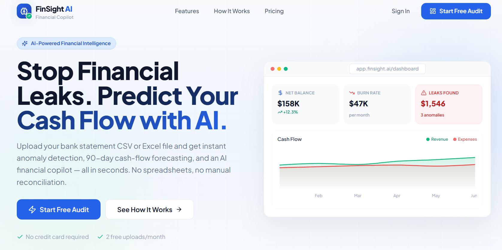

<br/><br/>

02. Pricing & Subscription Plans

Flexible subscription plans designed for different business needs and growth stages.

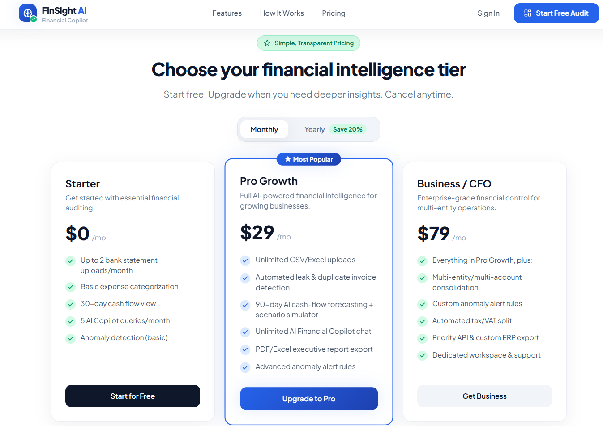

</div>

---

## Table of Contents

- [1. Overview](#-1-overview)
- [2. The Problem](#-2-the-problem)
- [3. The Solution](#-3-the-solution)
- [4. Who Is It For?](#-4-who-is-it-for)
- [5. Product Capabilities](#-5-product-capabilities)
- [6. Platform Screenshots](#-6-platform-screenshots)
- [7. How It Works](#-7-how-it-works)
- [8. System Architecture](#-8-system-architecture)
- [9. Financial Intelligence Engines](#-9-financial-intelligence-engines)
- [10. Business Intelligence & Reporting](#-10-business-intelligence--reporting)
- [11. Subscription Model](#-11-subscription-model)
- [12. Technology Stack](#-12-technology-stack)
- [13. Project Structure](#-13-project-structure)
- [14. Getting Started](#-14-getting-started)
- [15. Supabase Configuration](#-15-supabase-configuration)
- [16. Security & Data Handling](#-16-security--data-handling)
- [17. Current Limitations](#-17-current-limitations)
- [18. Product Roadmap](#-18-product-roadmap)
- [19. Contributing](#-19-contributing)
- [20. License](#-20-license)

---

##  1. Overview

Businesses generate financial data every day: transactions, expenses, revenues, supplier payments, operational costs, and financial statements.

However, having financial data does not automatically mean having financial visibility.

Many organizations still depend on spreadsheets, fragmented tools, and manual reporting processes to understand their financial performance.

**FinSight AI addresses this gap.**

It transforms uploaded financial statements into an interactive financial intelligence environment where users can:

- Understand their financial position through real-time dashboard calculations.
- Monitor cash flow, revenue, expenses, and financial health.
- Identify unusual transactions and potential financial leaks.
- Forecast future cash positions.
- Simulate different financial scenarios.
- Interact with financial data through an AI-assisted copilot.
- Generate structured financial and executive reports.

The platform is designed around a simple principle:

> Financial data should not simply be stored and displayed. It should be understood, analyzed, and transformed into decisions.

##  2. The Problem

Financial visibility remains a challenge for many businesses, particularly SMEs, startups, independent professionals, and growing organizations.

Common challenges include:

| Business Challenge | Business Impact |
|---|---|
| Fragmented financial information | Limited visibility into overall performance |
| Manual spreadsheet analysis | Time-consuming reporting processes |
| Unnoticed recurring expenses | Potential financial losses |
| Limited forecasting capabilities | Difficulties anticipating cash-flow problems |
| Reactive financial management | Decisions made without sufficient analytical context |
| Complex reporting processes | Delayed management information |

Traditional financial tools often focus on recording transactions or displaying historical figures.

Businesses also need tools that help them understand what happened, identify what deserves attention, and explore what could happen next.

##  3. The Solution

FinSight AI combines financial data processing, business intelligence, analytical engines, forecasting, and AI-assisted interaction in one platform.

### From raw financial data to actionable intelligence

| Stage | Platform Capability | Business Value |
|---|---|---|
| 01. Ingestion | CSV and Excel financial data import | Centralized financial information |
| 02. Processing | Automatic parsing, normalization, and classification | Structured and usable data |
| 03. Analytics | Financial KPIs and interactive dashboards | Better financial visibility |
| 04. Detection | Configurable anomaly and spending detectors | Identification of potential inefficiencies |
| 05. Forecasting | Cash-flow projections and scenario simulation | Forward-looking financial analysis |
| 06. Intelligence | AI-assisted financial questions and explanations | Easier access to financial insights |
| 07. Reporting | PDF, Excel, and structured exports | Decision-ready financial information |

The result is a unified environment for financial monitoring, analysis, and decision support.

##  4. Who Is It For?

FinSight AI is designed for professionals and organizations that need clearer financial visibility.

| Target Audience | Potential Use Cases |
|---|---|
| SMEs | Monitor expenses, cash flow, and financial performance |
| Startups | Track burn rate, runway, and financial sustainability |
| Freelancers | Understand income, spending, and available cash |
| Entrepreneurs | Evaluate financial performance and simulate business decisions |
| Finance Managers | Monitor financial indicators and investigate anomalies |
| Accountants | Analyze financial statements and prepare reports |
| Consultants | Deliver structured financial analysis to clients |
| Business Executives | Access financial summaries and management insights |

Whether managing a small business or analyzing multiple financial datasets, the objective is the same: make financial information more accessible and useful.

##  5. Product Capabilities

FinSight AI is organized into three functional areas containing nine integrated modules.

### A. Financial Command Center

**1. Dashboard Overview**

A centralized view of the financial situation.

- Current financial balance and net cash position.
- Monthly burn rate.
- Estimated financial runway.
- Financial health score.
- Potential financial leaks.
- 90-day cash-flow projection.
- Automatically generated executive summary.

**2. Data Manager**

A dedicated environment for financial data management.

- Drag-and-drop CSV and Excel imports.
- Multiple dataset management.
- Dataset switching.
- Upload history.
- Editable opening balance.
- Financial period comparison.
- Multi-entity consolidation support.

**3. Live BI Analytics**

Interactive financial dashboards for exploring business performance.

- Revenue versus expenses.
- Cash-flow evolution.
- Spending distribution by category.
- Top vendors and suppliers.
- Monthly category trends.
- Client revenue distribution.
- Spending patterns by weekday.
- Historical period filters.

### B. Financial Intelligence

**4. Anomaly & Leak Detector**

A configurable analytical engine designed to identify potentially unusual financial activity.

Detection capabilities include:

- Duplicate transaction detection.
- Unusual vendor price increases.
- Abnormally large expenses.
- Unusual weekend spending.
- Category-level spending spikes.

Each finding includes an estimated amount, severity, and recommended action.

Users can review findings, mark them as ignored, or manage their investigation status.

**5. Scenario Simulator**

Explore hypothetical financial situations before making business decisions.

Four adjustable financial levers:

- Revenue growth or decline.
- Marketing expenditure changes.
- Operational cost reductions.
- Potential financial leak elimination.

The simulator recalculates the 90-day financial projection as assumptions change.

**6. AI Financial Copilot**

An AI-assisted interface for interacting with financial information.

Users can ask questions about:

- Total revenue and expenses.
- Financial rankings.
- Period comparisons.
- Cash-flow performance.
- Estimated financial runway.
- Detected anomalies.
- Financial trends and explanations.

The copilot uses the active financial dataset and a local query engine, with optional OpenAI or Groq integration.

### C. Reporting & Financial Control

**7. Executive Reports**

Generate structured financial information for management and reporting.

Available exports include:

- Executive financial report.
- PDF through browser printing.
- Excel financial workbook.
- Anomaly CSV export.
- ERP journal export.
- VAT breakdown.

**8. Transaction Ledger**

A centralized financial transaction explorer.

- Search transactions.
- Sort financial records.
- Filter by transaction attributes.
- Review transaction details.
- Explore the active dataset.

**9. Alert Rules & Settings**

Configure the platform's monitoring behavior.

- Adjust anomaly detection sensitivity.
- Define custom alert thresholds.
- Monitor generated alerts.
- Review synchronization status.
- Manage workspace settings.

---

##  6. Platform Screenshots

The following section presents the main areas of the FinSight AI interface.

> Place your actual application screenshots inside the `docs/screenshots/` directory.

### Platform Overview

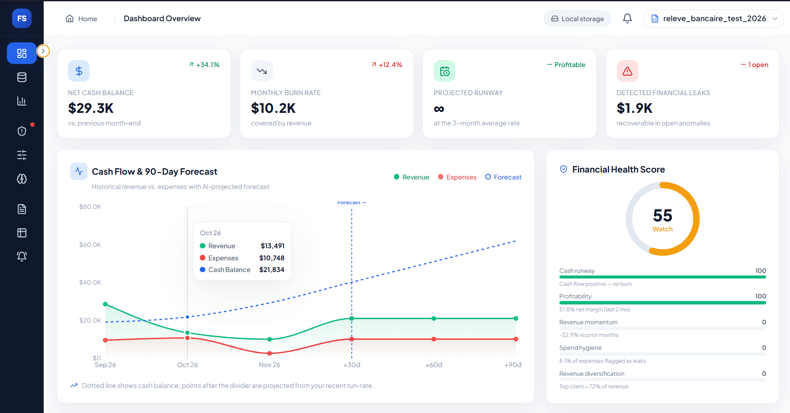

*Centralized financial dashboard with key indicators and financial performance monitoring.*

### Financial Data Management

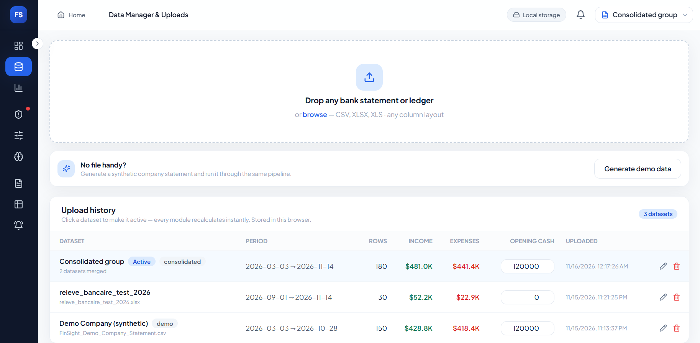
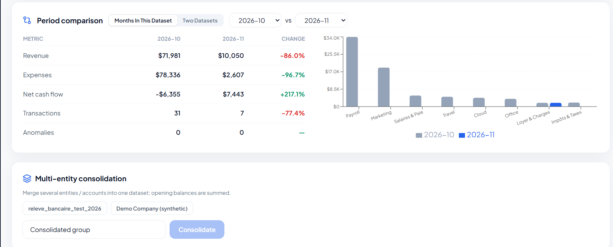

*Import, organize, and manage financial datasets.*

### Business Intelligence Analytics

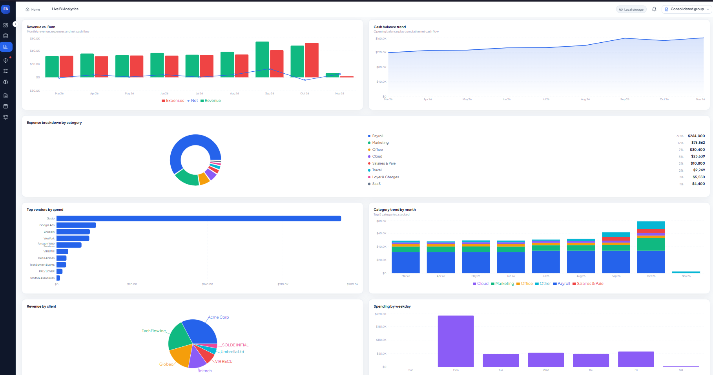

*Interactive financial visualizations and performance analysis.*

### Financial Intelligence

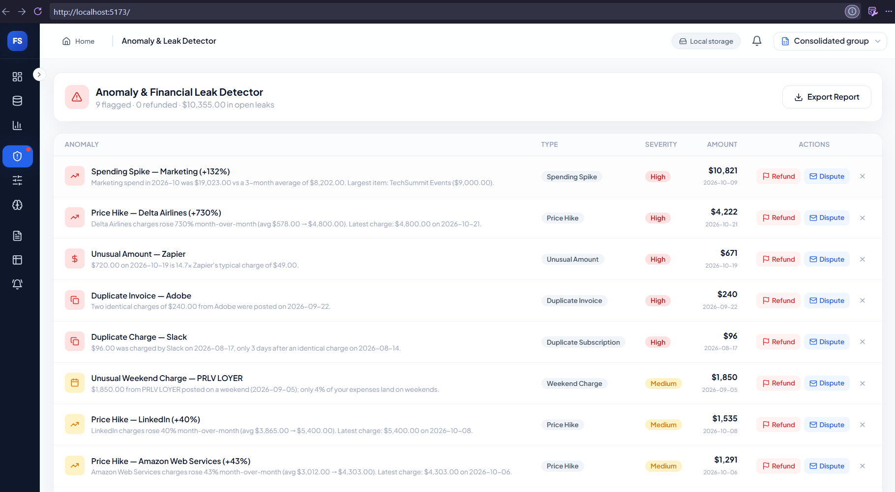

*Identification and investigation of potentially unusual financial transactions.*

### Scenario Simulation

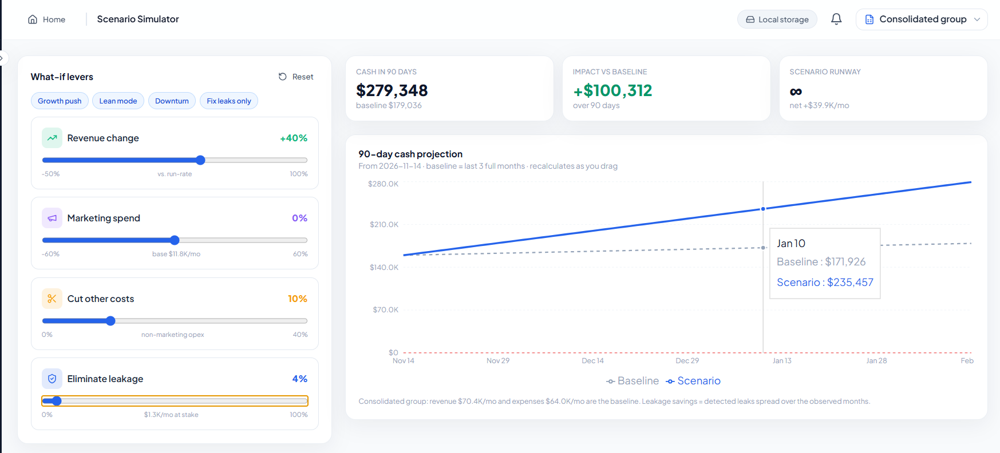

*Explore financial assumptions and evaluate projected outcomes.*

### AI Financial Copilot

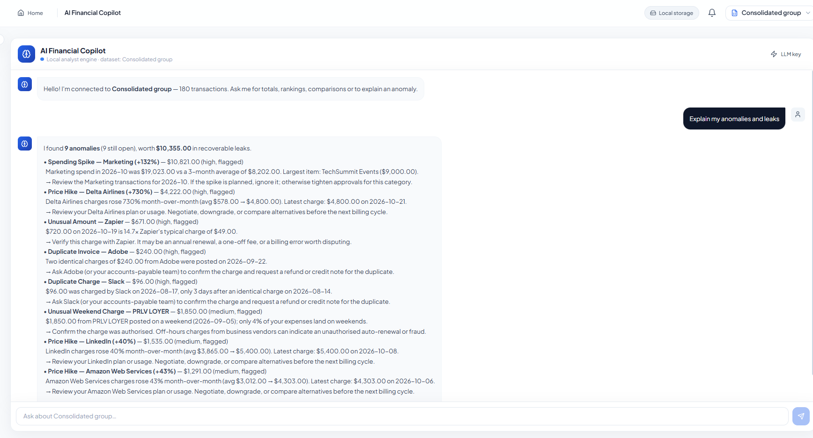

*Interact with financial information through an AI-assisted interface.*

### Executive Reporting

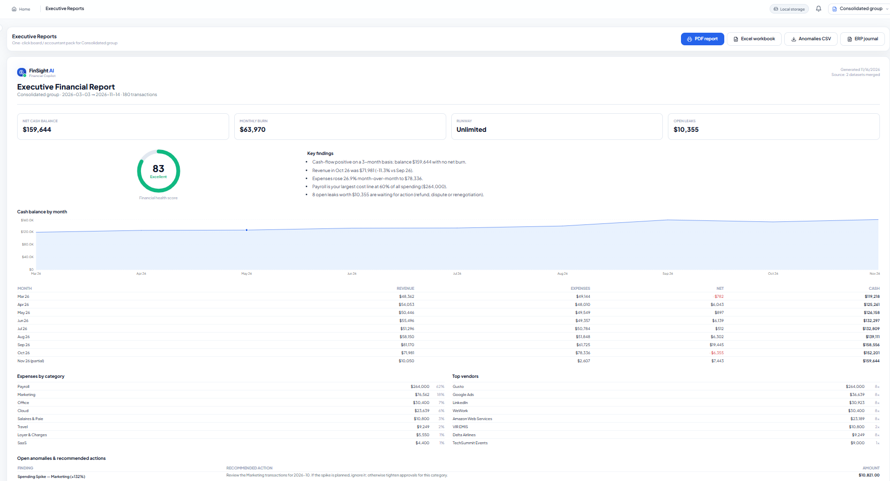

*Access structured reports and financial exports.*

---

##  7. How It Works

FinSight AI follows a structured data-to-intelligence workflow.

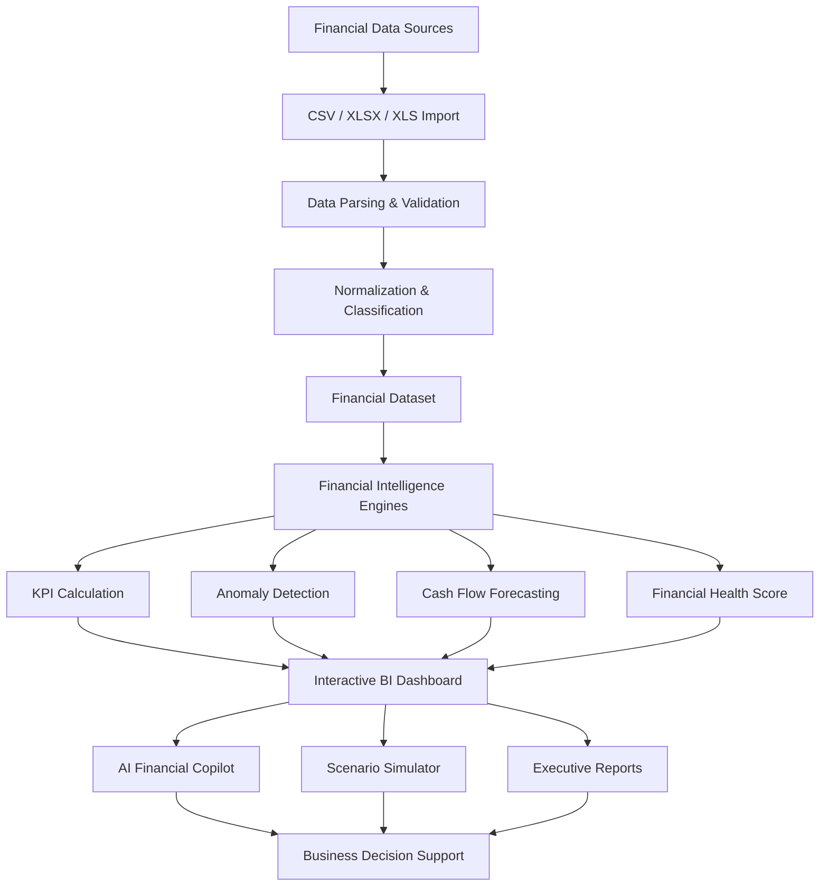

### Intelligent Financial Data Ingestion

The platform supports financial data imports from:

- CSV files.
- XLSX workbooks.
- XLS Excel files.

The import engine is designed to handle differences between financial statement formats.

Its processing capabilities include:

| Data Challenge | Processing Approach |
|---|---|
| Titles above the table | Header detection across the first 25 rows |
| Different column names | Name-based matching and content-based fallback |
| Debit and credit columns | Transaction direction inference |
| Different date formats | Column-level date interpretation |
| Excel serial dates | Date conversion |
| International number formats | Locale-aware numerical parsing |
| Invalid records | Validation and import reporting |
| Multiple Excel sheets | Selection of the sheet with the most valid rows |
| Missing categories | Category inference from transaction descriptions and vendor keywords |

After import, the platform displays the mapped columns and skipped records in the import summary.

This makes the ingestion process more transparent and reduces the need for manual restructuring.

---

##  8. System Architecture

FinSight AI follows a modular frontend architecture with centralized workspace management and independent financial calculation engines.

### Architecture Overview

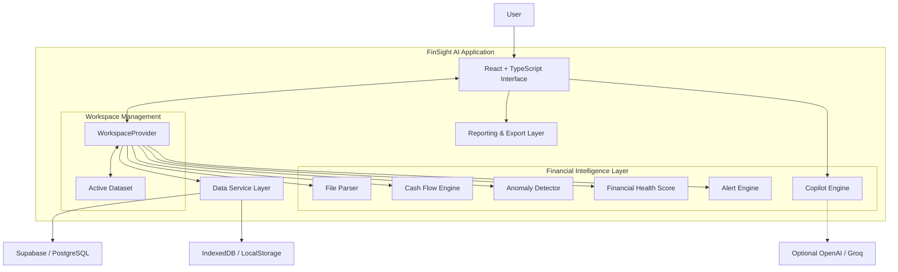

### Key Architectural Principles

**1. Centralized Workspace Management**

`WorkspaceProvider` maintains the active financial dataset and provides a consistent source of information for the application's modules.

**2. Modular Analytical Engines**

Financial calculations are separated into independent modules under `src/lib`.

This improves maintainability, separation of concerns, and testability.

**3. Flexible Data Persistence**

The data service layer supports two storage modes:

- Supabase when configured.
- Browser-based IndexedDB persistence as a fallback.

**4. Optional AI Integration**

The financial copilot can operate with its local query engine, with optional external LLM integration.

---

##  9. Financial Intelligence Engines

FinSight AI combines several analytical engines to transform transaction-level data into financial indicators.

### 9.1 Cash-Flow Analysis & Forecasting

The cash-flow engine aggregates financial transactions into monthly financial information.

Its calculations include:

- Monthly revenue.
- Monthly expenses.
- Net cash flow.
- Financial balance.
- Burn rate.
- Estimated runway.
- 90-day projection.

**Baseline methodology**

The current baseline uses the average of the last three complete months.

Incomplete periods are identified and excluded according to the implemented completeness rule.

**Runway calculation**

When the monthly net burn is positive:

`Runway (days) = Available Balance / Monthly Net Burn × 30`

When revenue covers expenses, the platform displays an infinite runway rather than a negative burn-based estimate.

**Scenario simulation**

The projected cash position is recalculated using adjustable assumptions for revenue, marketing expenditure, operating costs, and potential leak elimination.

### 9.2 Anomaly Detection

The platform currently implements five configurable detection mechanisms.

| Detector | Analytical Rule | Default Configuration |
|---|---|---|
| Duplicate Charges | Same vendor and amount within a defined period | 7 days, minimum $20 |
| Vendor Price Hikes | Increase in average vendor charge | +25%, minimum $100 |
| Unusual Amounts | Transaction significantly above vendor median | 3×, minimum $500 |
| Weekend Spending | Large weekend expenses | Minimum $200 |
| Category Spending Spikes | Monthly category spending versus historical average | +50%, minimum $500 |

Detection thresholds can be adjusted through the platform settings.

Each finding includes a severity level, estimated financial impact, and suggested action.

Only findings classified as recoverable contribute to the financial leaks indicator.

### 9.3 Financial Health Score

FinSight AI calculates a financial health score between 0 and 100.

The implemented scoring model considers five dimensions:

| Financial Dimension | Weight |
|---|---:|
| Cash Runway | 30% |
| Profitability | 25% |
| Revenue Momentum | 15% |
| Spending Hygiene | 15% |
| Revenue Diversification | 15% |
| **Total** | **100%** |

The objective is to provide a simplified overview of financial performance through multiple complementary indicators.

This score is an internal analytical indicator, not a credit rating or a certified financial assessment.

---

##  10. Business Intelligence & Reporting

FinSight AI is designed to make financial information easier to explore, interpret, and communicate.

### Business Intelligence

Interactive visualizations support:

- Historical financial performance.
- Revenue and expenditure analysis.
- Spending distribution.
- Vendor-level analysis.
- Financial trends.
- Period comparisons.

### Executive Reporting

The reporting module helps users transform analytical results into structured information for management.

Supported exports include:

| Format | Purpose |
|---|---|
| PDF | Executive and financial reporting through browser printing |
| Excel | Structured financial workbook |
| CSV | Anomaly and transaction-related exports |
| ERP Journal | Structured accounting journal export |
| VAT | Financial tax breakdown |

---

##  11. Subscription Model

FinSight AI includes a subscription-oriented product structure designed around different business needs.

The current interface provides three subscription tiers.

| Capability | Starter | Pro Growth | Business / CFO |
|---|---:|---:|---:|
| Monthly Price | Free | $29 | $79 |
| Monthly Uploads | 2 | Unlimited | Unlimited |
| Copilot Questions | 5 | Unlimited | Unlimited |
| Duplicate Detection | ✓ | ✓ | ✓ |
| Forecast Horizon | 30 days | 90 days | 90 days |
| Core Dashboards | ✓ | ✓ | ✓ |
| Advanced Analytics | — | ✓ | ✓ |
| All Anomaly Detectors | — | ✓ | ✓ |
| Scenario Simulator | — | ✓ | ✓ |
| PDF / Excel Exports | — | ✓ | ✓ |
| Detector Configuration | — | ✓ | ✓ |
| Period Comparison | — | ✓ | ✓ |
| Multi-Entity Consolidation | — | — | ✓ |
| Custom Alerts | — | — | ✓ |
| VAT Breakdown | — | — | ✓ |
| ERP Journal Export | — | — | ✓ |

**Important:** Subscription tiers, feature restrictions, and upgrade interfaces are currently part of the application experience. Checkout is simulated; real payment processing and subscription management have not yet been implemented.

---

##  12. Technology Stack

The project uses a modern frontend ecosystem focused on modularity, performance, and maintainability.

| Layer | Technology | Responsibility |
|---|---|---|
| Frontend | React 18 | User interface |
| Language | TypeScript 5 | Type safety |
| Styling | Tailwind CSS 3 | Responsive interface |
| Build Tool | Vite 7 | Development and production builds |
| Visualization | Recharts 3 | Financial charts |
| Icons | Lucide React | Interface icons |
| CSV Processing | PapaParse | CSV ingestion |
| Excel Processing | SheetJS | Excel workbook parsing |
| State Management | React Context / Hooks | Workspace state |
| Primary Persistence | Supabase | PostgreSQL-based persistence |
| Local Persistence | IndexedDB | Browser-based storage |
| AI Integration | OpenAI / Groq (optional) | AI-assisted financial interaction |

### Technology Highlights

- TypeScript for structured application development.
- Independent analytical engines for financial calculations.
- Modular components for easier feature development.
- Recharts for interactive data visualization.
- Flexible persistence through Supabase and IndexedDB.
- Optional LLM integration for natural-language financial interaction.

---


---

##  14. Getting Started

Follow these instructions to run FinSight AI locally.

### Prerequisites

Make sure you have installed:

- Node.js 18 or higher.
- npm.
- Git.

### 1. Clone the repository

```bash
git clone <YOUR-GITHUB-REPOSITORY-URL>
```

### 2. Navigate to the project

```bash
cd finsight-ai
```

### 3. Install dependencies

```bash
npm install
```

### 4. Start the development server

```bash
npm run dev
```

### 5. Open the application

Navigate to:

```text
http://localhost:5173
```

Start the free audit, upload a financial statement, or generate demo data to explore the platform.

### Windows Quick Start

Windows users can alternatively launch:

```text
start-project.bat
```

The script installs dependencies on the first run and starts the development server.

### Available Commands

| Command | Description |
|---|---|
| `npm run dev` | Start the development server |
| `npm run build` | Build the production application |
| `npm run preview` | Preview the production build |
| `npm run typecheck` | Run TypeScript checks |

---

##  15. Supabase Configuration

Supabase is optional.

Without Supabase configuration, the application uses its local browser persistence mode.

### Setup

**Step 1. Create a Supabase project**

Visit [Supabase](https://supabase.com/) and create a project.

**Step 2. Enable anonymous authentication**

Navigate to:

`Authentication → Providers`

Enable anonymous sign-ins.

**Step 3. Apply the database migration**

Open the Supabase SQL Editor and execute:

```text
supabase/migrations/20261115000000_finsight_schema.sql
```

**Step 4. Configure environment variables**

Create a `.env` file using `.env.example` as a template.

```env
VITE_SUPABASE_URL=https://YOUR-PROJECT.supabase.co
VITE_SUPABASE_ANON_KEY=YOUR-ANON-KEY
```

**Step 5. Restart the development server**

```bash
npm run dev
```

The application will use Supabase when the required configuration is available.

### Data Model

The current database structure revolves around three main entities:

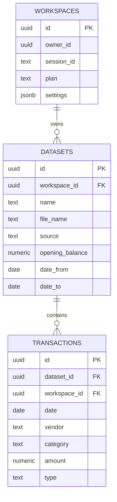

Row Level Security policies are used to restrict access to workspace data according to the configured ownership model.

---

##  16. Security & Data Handling

Financial information requires careful handling.

The current implementation includes several security-oriented measures:

| Area | Implementation |
|---|---|
| Database Access | Supabase Row Level Security policies |
| Local Storage | Browser-based IndexedDB persistence |
| AI Output | React-based rendering instead of raw HTML injection |
| CSV Exports | Formula injection mitigation |
| LLM Requests | Aggregated financial information rather than raw transaction rows |
| API Credentials | Optional provider keys stored in session storage |

### Important Production Considerations

The current implementation is a development-stage product and should not be considered a fully production-hardened financial platform.

Before commercial deployment, additional measures are necessary:

- Server-side AI request handling.
- Secure authentication and account management.
- Server-side subscription and payment verification.
- Production-grade authorization and access controls.
- Security testing and dependency auditing.
- Data retention and deletion policies.
- Appropriate encryption and operational monitoring.
- Compliance and privacy review according to applicable regulations.

**Never use real sensitive financial information in an untrusted or unsecured deployment.**

---

##  17. Current Limitations

Transparency is important when evaluating the platform.

The current implementation has the following limitations:

- Subscription checkout is simulated; no real payments are processed.
- Authentication currently relies on anonymous browser sessions.
- The AI copilot can use external provider keys configured in the browser.
- PDF generation uses the browser's print functionality.
- The production bundle requires further optimization.
- Currency formatting currently uses USD; automatic multi-currency conversion is not implemented.
- Direct bank-feed integrations are not yet implemented.

These limitations define areas for future engineering and product development.

---

##  18. Product Roadmap

The long-term direction is to evolve FinSight AI into a more comprehensive financial intelligence platform.

### Product Evolution

- [ ] Production-ready authentication and account management.
- [ ] Secure team workspaces and collaboration.
- [ ] Real Stripe Checkout and webhook-based subscription management.
- [ ] Server-side AI integration and API security.
- [ ] Direct bank-feed integrations.
- [ ] Multi-currency financial analysis and exchange-rate support.
- [ ] Advanced financial forecasting models.
- [ ] Customizable financial dashboards.
- [ ] Improved import mapping for complex financial statements.
- [ ] Automated testing for financial calculation engines.
- [ ] Performance optimization and application code splitting.
- [ ] Advanced reporting and financial analytics.

The roadmap is intended to guide the platform toward stronger scalability, usability, and commercial readiness.

---

##  19. Contributing

Contributions, suggestions, and technical feedback are welcome.

If you would like to contribute:

1. Fork the repository.
2. Create a feature branch.
3. Implement your changes.
4. Test the affected functionality.
5. Submit a pull request with a clear description.

For significant changes, consider opening an issue first to discuss the proposed improvement.

---

##  20. License

A license has not yet been specified.

Please contact the repository owner regarding usage, distribution, and commercial permissions.

---

<div align="center">

# FinSight AI

**See your finances. Understand your business. Make smarter decisions.**

Financial data is only valuable when it drives better decisions.

*Turning financial information into actionable business intelligence.*

</div>